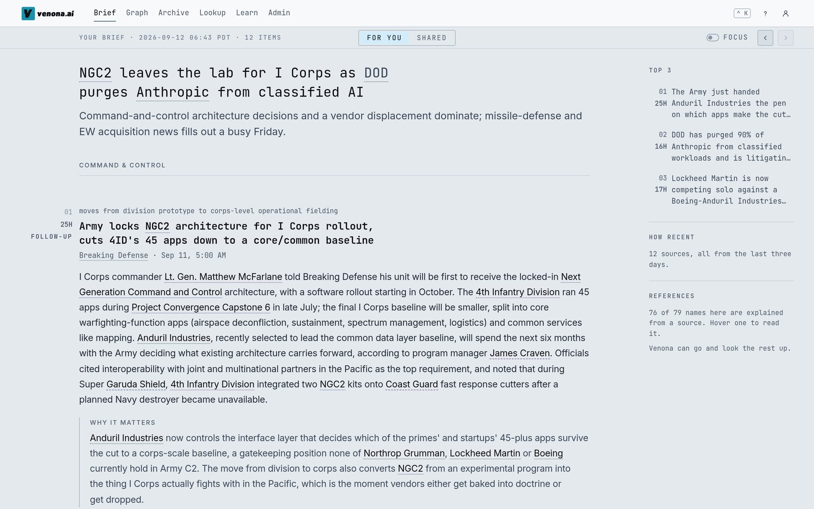
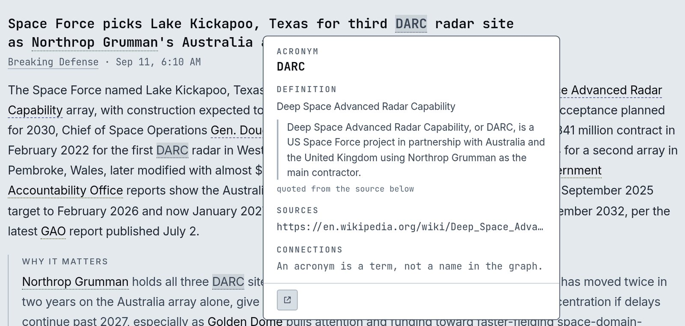
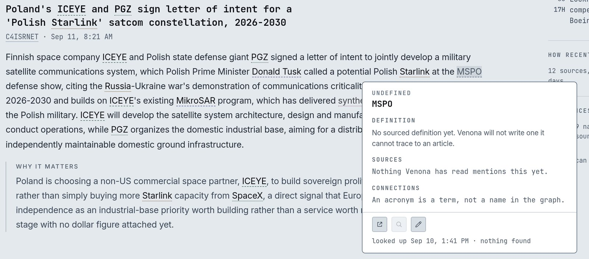
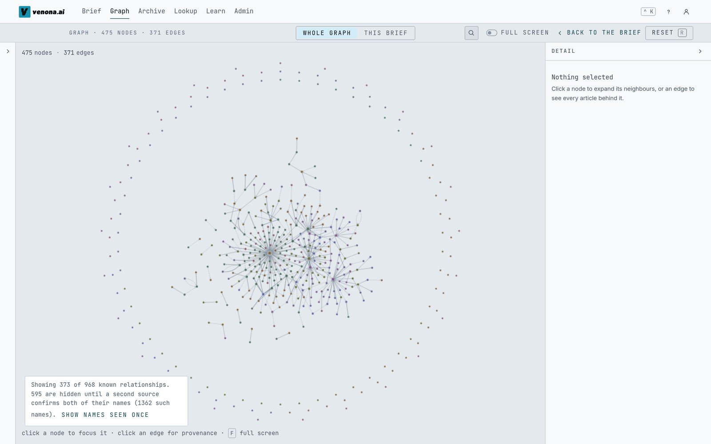
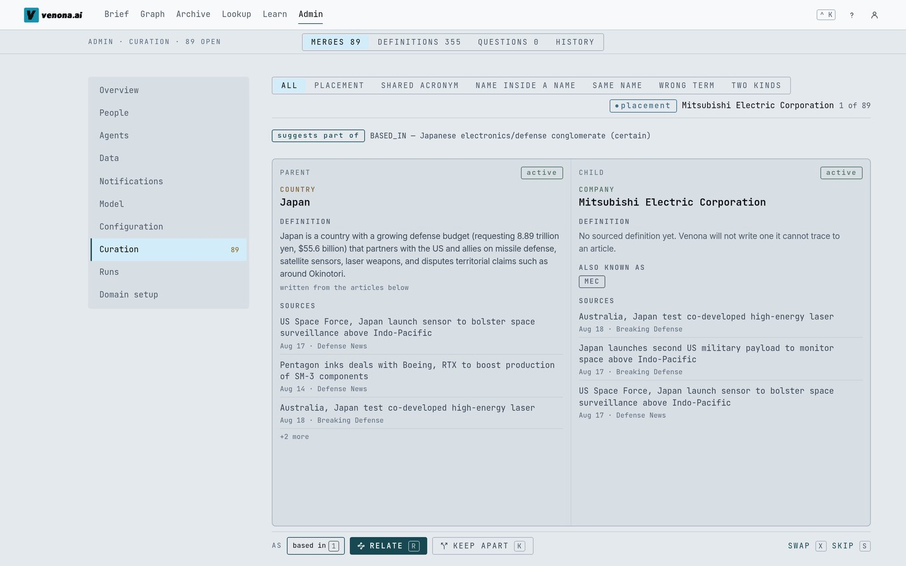
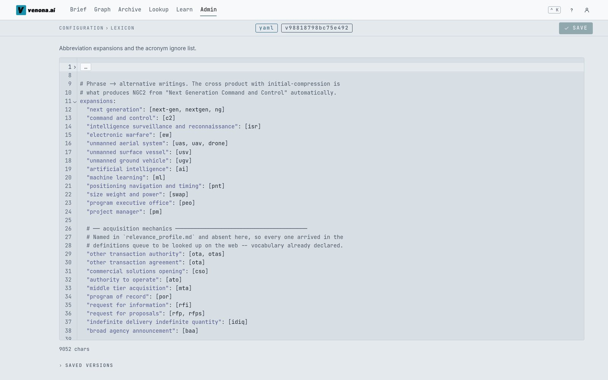
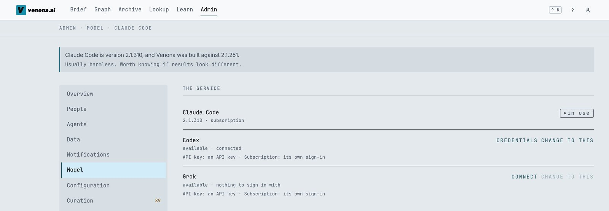

# Venona

Venona reads a field's trade press every day, scores each article against a
relevance profile you write, and pulls the organisations, people, programs and
the relationships between them into a knowledge graph. It writes a daily brief
in which every name and acronym is hoverable.

It was built to read the defense trade press. Everything specific to that
domain lives in configuration (`config/` and `profile/`), so it can be pointed
at any field with its own vocabulary.

## Status

**Not maintained.** This is released as-is under the MIT license. Issues and
pull requests will not be reviewed. Fork it and make it yours.

Why it exists and what it is like to use:
[Venona is open source](https://hoursafield.com/notes/2026-11-01-venona-is-open-source).



## What it does

- **The brief.** Written prose where every program name and acronym is
  hoverable. The card gives the definition, the sentence it came from, what has
  been said about it lately, and what it connects to.
- **The graph.** Expand, filter, trace paths between two names, and audit every
  edge back to the article that asserted it.
- **The browser extension.** The same underlines and definitions on any page you
  are reading. See `extension/README.md`.
- **Agent access.** A read-only MCP server, so an assistant can look a name up,
  ask what it connects to, and read the sentence a definition came from. No tool
  starts a run, spends, or writes anything. See `docs/USER-GUIDE.md` §12.







Three rules hold the data together:

1. A definition exists only if it can be traced to a sentence in a document.
   Nothing is expanded from a model's memory. Undefined terms render as
   undefined.
2. The model decides which entities appear in a document; code decides where.
   Spans are matched against an alias index, never taken from model offsets.
3. Postgres is the system of record. Neo4j is a projection that
   `venona graph rebuild` can reconstruct from the `assertions` table.

Two names merge automatically only when the code can prove they are the same
(a name and the acronym it spells, a corporate suffix, an alias you declared).
Everything else is a proposal you approve in the curation queue.



## Your own domain

The ontology, sources, lexicon, relevance profile, scoring rubric, brief
sections and prompts are all files under `config/` and `profile/`, editable from
the Admin screens in the browser. On a blank instance a setup wizard drafts each
of them from a short description of your field, and you review every draft
before it is applied.



To run a second instance beside the first, on its own ports and database:

```bash
make new-local-instance SLUG=mydomain
make dev INSTANCE=mydomain
```

`docs/EXTENDING.md` has checklists for adding a source, an entity type, a
scoring axis or a stage.

## Requirements

- Docker (Postgres and Neo4j)
- Node 20+
- One model service's CLI, signed in (see below). Claude Code is the default.
- `uv` (installed by `make setup` if missing). Python 3.12 is pinned.

### Model services

Venona does its model work through a command-line agent rather than calling an
API directly. Three are supported, and you switch between them under
**Admin, Model** (or `llm.harness` in `config/settings.yaml`):

| Service | CLI | Sign-in |
|---|---|---|
| Claude Code (default) | [`claude`](https://claude.com/claude-code) | your Claude Pro or Max subscription (`claude auth login`, or a token from `claude setup-token` pasted into Admin, Model), or an Anthropic API key |
| Codex | `codex` | your ChatGPT subscription (`codex login`), or an OpenAI API key |
| Grok | `grok` | its own sign-in, or an xAI API key. The least exercised of the three |



`llm.billing_mode` says which kind you are paying for. On a **subscription**
the limit is the plan's usage window, and cost figures are what the same tokens
would have cost at list price. With an **API key** the money is real and
`llm.max_spend_usd_per_run` caps each run. Venona refuses to start if it finds
an API key on an instance set to subscription, so a flat-rate plan is never
silently billed per token. `docs/ADMIN-GUIDE.md` §9 and §10 have the detail.

## Setup

```bash
cp .env.example .env
make setup
```

That installs `uv`, pins Python 3.12, syncs both dependency trees, starts
Postgres and Neo4j, applies migrations, and prints a health line:

```
api ok · neo4j ok (5.26.28 community) · claude ok (2.1.251, claude.ai, max) · active_run none
```

If any of those is red, `docs/RUNBOOK.md` covers the usual causes.

## Running

```bash
make dev            # api on :8000, ui on :5173
```

That is the whole app for one reader. With `VENONA_AUTH_ENABLED=0` in `.env`
(the default in `.env.example`) there is no sign-in at all. To require sign-in
on a single instance, configure Google directly with the `VENONA_GOOGLE_*`
variables in `.env.example`.

### The hub (optional)

`hub/` is only needed when you run several instances and want one sign-in and
central management across them: an OIDC issuer, an instance directory, a
chooser, and a management channel that polls each instance's health. A single
instance never needs it.

```bash
cp .env.hub.example .env.hub   # then fill in the secrets and a Google OAuth client
make dev-hub                   # the hub on :8180, plus this instance
make dev INSTANCE=other        # each further instance, beside it
```

`docs/HUB.md` covers registering instances. The hub also contains Stripe
billing from when this was going to be a product. It is off unless the
`HUB_STRIPE_*` variables are set (`docs/DEV-BILLING.md`), and `make dev-hub`
runs fine without the Stripe CLI installed.

Both targets reclaim their own ports first. `make ports` shows what is
listening, and `make stop` frees :8000 and :5173.

## Development

```bash
make seed       # load fixture data: full UI, zero network, zero model spend
make test       # offline test suite
make lint       # ruff + design-token + determinism + ontology + generated-file checks
make health
make reset      # wipe volumes + db, re-migrate, re-seed
```

The browser extension and the two browser-driven checks:

```bash
make ext-build  # extension -> extension/dist (regenerates its styles)
make ext-smoke  # headless Chrome checks. READ-ONLY, safe anywhere
make ui-smoke   # drives the real app. It WRITES: throwaway instances only
```

`ui-smoke` needs `VENONA_UI_SMOKE=1` and refuses to start without it.

### Offline mode

`VENONA_OFFLINE=1` swaps in recorded model responses, recorded HTTP responses, a
frozen clock and a seeded id generator, so two runs over the same fixtures
produce identical output. The test suite runs this way: no network, no spend.

The repository ships the recorded model responses the tests need, but not the
recorded web pages, which were third-party articles. To run the whole pipeline
offline, record your own first:

```bash
make record
VENONA_OFFLINE=1 uv run venona run
```

## Layout

| Path | What |
|---|---|
| `profile/` | Relevance profile, prompts, rubric, sections, lexicon, anchors. |
| `config/` | Settings, sources, ontology and the domain descriptor. |
| `backend/venona/` | Pipeline, graph projection, API, MCP server. |
| `web/src/` | Vue 3 interface. |
| `extension/` | Chrome MV3 extension. Annotates third-party pages. |
| `hub/` | Optional OIDC issuer and instance directory. |
| `fixtures/` | Recorded model responses, seed data, golden files. |
| `docs/` | Contracts, data model, design, runbook, decision records. |

## Documentation

| Doc | Read it when |
|---|---|
| `docs/USER-GUIDE.md` | Using the app in a browser |
| `docs/ADMIN-GUIDE.md` | Running an instance and curating it |
| `docs/CONTRACTS.md` | Changing anything that crosses a module boundary |
| `docs/DATA-MODEL.md` | Changing the schema or the id scheme |
| `docs/DESIGN.md` | Touching the interface |
| `docs/EXTENDING.md` | Adding a source, entity type, scoring axis, or stage |
| `docs/adr/` | Something looks wrong and you want to "fix" it |
| `docs/RUNBOOK.md` | It broke |
| `extension/README.md` | Building, loading or configuring the browser extension |
| `CLAUDE.md` | You are a coding agent |

## License

MIT. See `LICENSE`. Third-party notices are in `THIRD_PARTY_NOTICES.md`.
